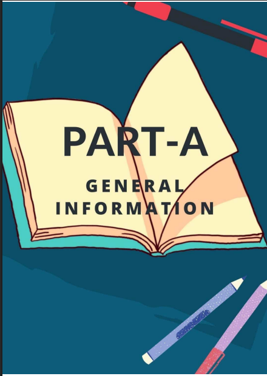
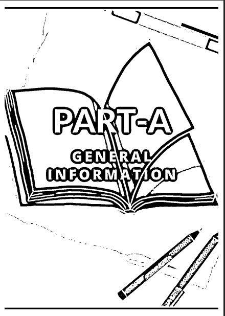
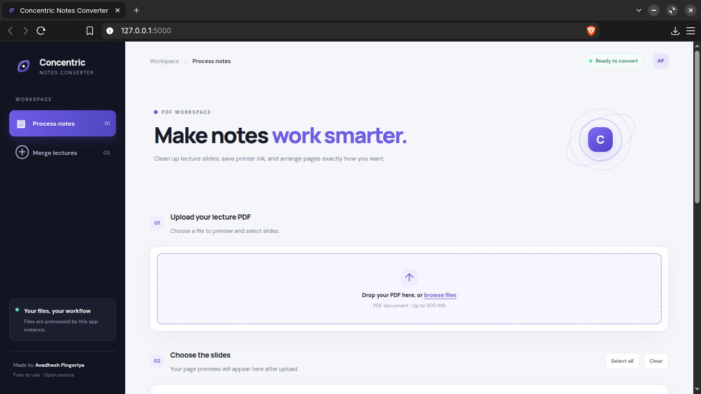
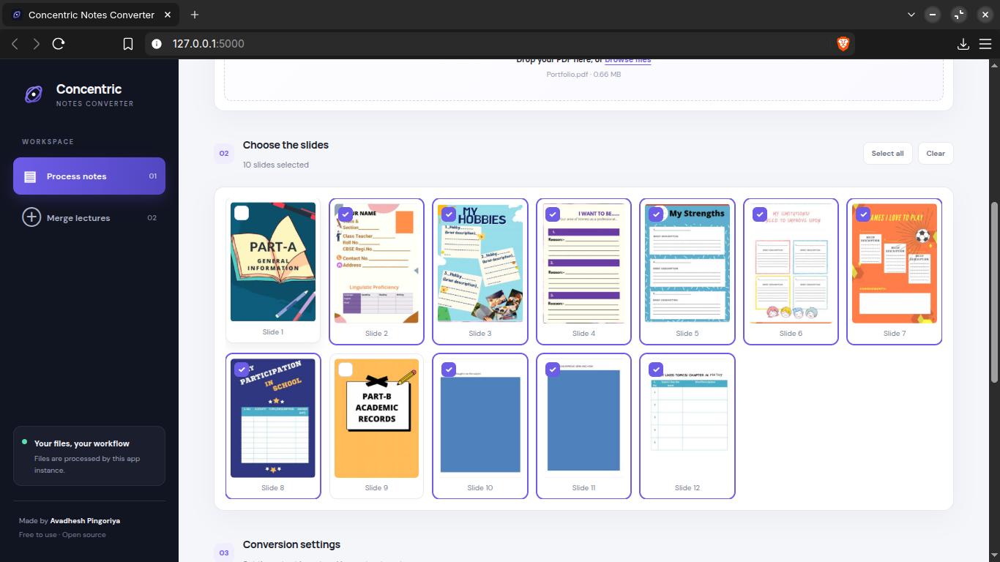
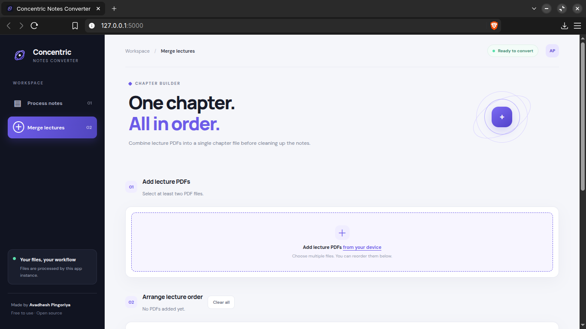

# 🟣 Concentric Notes Converter

### Smarter notes. Less unnecessary ink. More affordable studying.

**Concentric Notes Converter** is a PDF processing tool designed for students who want to turn lecture slides into printer-friendly study notes.

Convert colourful slides into black-and-white output, experiment with ink-saving processing, choose which slides to print, fit multiple slides on a single sheet, and merge lecture PDFs into organised study material.

Built with Python and a browser-based interface, Concentric Notes Converter aims to make everyday study preparation practical, lightweight, and accessible, even on older computers.

<p align="center">
  <a href="https://github.com/avadhesh0003/concentric-notes-converter">
    
  </a>
  
  
</p>

---

## ✨ Why Concentric Notes Converter?

Lecture PDFs are often designed for presentation screens, not printing. Large coloured backgrounds, decorative graphics, and full-page designs can make printed notes expensive or inconvenient.

Concentric Notes Converter gives you more control over how your lecture material looks on paper.

- 🖨️ **Printer-friendly output:** Convert slides into black-and-white or grayscale versions.
- 🖋️ **Smart Ink Saver:** Reduce unnecessary background coverage in suitable slides.
- 📄 **Save paper:** Arrange up to eight slides on a single sheet.
- 🎯 **Print what matters:** Select individual slides instead of processing everything.
- 📚 **Organise lectures:** Merge multiple PDFs into one document.
- 🥔 **Designed for modest hardware:** No dedicated graphics card is required for ordinary PDF processing.

---

## 🖼️ See the Difference

### Before and After

The following example shows an original coloured lecture slide and its processed black-and-white version.

<table>
  <tr>
    <th align="center">Before · Original Slide</th>
    <th align="center">After · Processed Slide</th>
  </tr>
  <tr>
    <td width="50%">
      
    </td>
    <td width="50%">
      
    </td>
  </tr>
</table>

The aim is to make lecture slides more convenient to print while keeping their educational content readable. Results depend on the original slide and the selected processing mode.

### Application Workspace



### Select the Slides You Need



### Customise Your Output


### Merge Lecture PDFs



---

## 🚀 Features

### 🖋️ Smart Ink Saver

Presentation slides can contain large areas of dark or saturated backgrounds that are unnecessary for many printed study notes.

Smart Ink Saver is designed to make suitable slides more printer-friendly by reducing unnecessary background coverage while retaining useful content.

- Intended for lecture slides and educational PDFs.
- Can help reduce large background areas in suitable images.
- Useful when preparing notes for physical revision.
- Results vary with slide design, colours, contrast, and content.

**Important:** Ink savings depend on the printer, print settings, paper, and source document. No fixed percentage of savings is guaranteed.

### 🎨 Multiple Processing Modes

Choose how your slides should be processed.

| Mode | Purpose |
|---|---|
| **Smart Ink Saver** | Makes suitable slides more printer-friendly by reducing unnecessary background coverage. |
| **Invert + B&W** | Inverts image tones and creates black-and-white output, useful for experimenting with dark-background slides. |
| **Grayscale** | Converts slide images into shades of grey. |
| **Original** | Keeps the original image appearance as much as the processing pipeline allows. |

### 🎯 Individual Slide Selection

Take control of your notes instead of printing an entire lecture.

- Preview PDF slides before processing.
- Select individual slides.
- Select all slides at once.
- Clear your current selection.
- Generate output from the slides you actually need.

### 📄 Multiple Slides Per Sheet

Fit more lecture content onto fewer printed pages.

Supported layouts:

`1 · 2 · 3 · 4 · 6 · 8 slides per page`

Choose portrait or landscape orientation to suit your content and preferred printing layout.

### ✏️ Adjustable Outline Strength

Use the outline-strength control to adjust the outline effect where supported by the processing pipeline. This can help you experiment with the appearance of processed slides before generating the final PDF.

### 📚 Merge Lectures

Keep related study material together.

- Upload multiple lecture PDFs.
- Arrange them in your preferred order.
- Combine them into a single PDF.
- Prepare one organised document for a chapter or topic.

### 🌐 Browser-Based Workspace

The interface runs in a web browser while the Python application handles processing.

- No dedicated GPU is needed for normal PDF tasks.
- Works locally on a supported Python environment.
- Uses common Python PDF and image-processing libraries.
- Can process files offline after setup, provided all required dependencies are already installed and the application does not rely on external services.

---

## 💻 System Requirements

Concentric Notes Converter is intended to be practical on low-end computers. The figures below are **initial targets**, not results from comprehensive hardware benchmarking.

| Component | Recommended minimum | Tested development laptop |
|---|---|---|
| **Processor** | 64-bit dual-core CPU | Intel Core i3-6006U |
| **Memory** | 2 GB RAM for light workloads | 8 GB RAM |
| **Architecture** | 64-bit x86 | 64-bit x86 |
| **Graphics** | Integrated graphics; no dedicated GPU required | Intel HD Graphics 520 |
| **Storage** | 500 MB free for application and dependencies, plus temporary working space | 128 GB SSD and 1 TB HDD |
| **Operating system** | A compatible 64-bit Linux environment with Python support | Zorin OS 18.1 Core |
| **Browser** | A recent compatible browser | Brave on Linux |

### 🥔 What about an old or low-end PC?

You do not need a gaming computer to process ordinary lecture PDFs.

- **2 GB RAM:** A reasonable target for light workloads, but larger PDFs may struggle.
- **4 GB RAM:** A more comfortable starting point for everyday use.
- **8 GB RAM:** Provides additional headroom for large documents and multitasking.
- **Dedicated graphics card:** Not required for the application's normal PDF and image-processing workflow.

The actual minimum depends on PDF size, page resolution, the processing mode, and available memory. Large files may need significantly more RAM and temporary storage.

**The tested configuration above is the laptop used during development.** It is not a claim that every operating system or every feature has been tested on all listed hardware configurations.

---

## 🛠️ Technology

Concentric Notes Converter uses the following technologies:

- **Python** for application logic.
- **Flask** for web routing and the local application server.
- **PyMuPDF** for PDF operations.
- **Pillow** for image manipulation.
- **OpenCV** for image processing.
- **NumPy** for numerical image operations.
- **HTML, CSS and JavaScript** for the browser interface.
- **Gunicorn** for WSGI server support.

---

## 📥 Installation

## 📱 Android Installation (Beta)

Concentric Notes Converter is now available for Android as an early beta! This version lets you convert colourful PDF pages into black-and-white notes directly on your Android device.

### 📥 Download

1. Open the [Releases page](https://github.com/avadhesh0003/concentric-notes-converter/releases).
2. Find **Concentric Notes Converter Android v0.1.0-beta**.
3. Download the APK file attached to that release.

### ⚙️ Installation

1. Download the APK to your Android phone.
2. Open the downloaded APK using your file manager.
3. If Android asks for permission to install apps from that source, allow it for your browser or file manager.
4. Review the installation prompt and tap **Install**.
5. Open Concentric Notes Converter after installation.

**Security notice:** Android or your device's security software may display a warning because this beta APK is distributed directly rather than through Google Play. This warning does not automatically mean the app is malicious. However, always download the APK from this repository's official Releases page and review the source code if you want to verify how the app works. Only proceed if you trust the source.

### 📋 Requirements

- Android 7.0 (Nougat) or newer.
- Storage space for the app and the PDFs you process.

### ✨ Available features

- Convert colourful PDF pages into black-and-white notes.
- Process PDFs locally on your device.

### ⚠️ Current limitations

This is an early beta, and some features available in the desktop version are not yet implemented on Android.

- **Multiple slides per page:** Not available yet.
- **Layout selection:** Not available yet.
- **App logo and icon:** Still being developed.
- **Additional processing modes:** Not available yet.

### 🚧 What's planned

- Support for 2, 3, 4, 6 and 8 slides per page.
- Layout and page orientation controls.
- Custom app icon and improved branding.
- More PDF processing options.

Please report bugs or share suggestions through the repository's [Issues page](https://github.com/avadhesh0003/concentric-notes-converter/issues).

Thank you for trying the beta! 💜

### 🪟 Windows · Easy Installation

**No Python installation or command-line setup required.**

1. Open the [Latest Release](https://github.com/avadhesh0003/concentric-notes-converter/releases/latest).
2. Under **Assets**, download `ConcentricNotesConverter.exe`.
3. Save the file somewhere convenient, such as your Downloads folder.
4. Double-click the EXE to launch Concentric Notes Converter.
5. Your default browser should open the local application automatically.

If Windows displays a Microsoft Defender SmartScreen warning, verify that you downloaded the file from the official project release. An unsigned application may trigger a warning. Only proceed if you trust the source.

**Troubleshooting**
- **The browser does not open:** Try visiting `http://127.0.0.1:5000` manually while the application is running.
- **The application fails to start:** Run the EXE from Command Prompt to inspect error messages, or report the issue in [GitHub Issues](https://github.com/avadhesh0003/concentric-notes-converter/issues).
- **The application is already running:** Close the previous instance before launching it again if both instances would use the same port.

The Windows executable is distributed through GitHub Releases. You do not need to clone the repository or install Python for the packaged version.


### 🐧 Linux

The application has been tested locally on Zorin OS 18.1 Core.

Install the prerequisites on a Debian-based distribution:

```bash
sudo apt update
sudo apt install python3 python3-pip python3-venv git
```

Clone the project and enter its directory:

```bash
git clone https://github.com/avadhesh0003/concentric-notes-converter.git
cd concentric-notes-converter
```

Create and activate a virtual environment:

```bash
python3 -m venv .venv
source .venv/bin/activate
```

Install dependencies and run the application:

```bash
python -m pip install --upgrade pip
pip install -r requirements.txt
python app.py
```

Alternatively, if you have installed the project's Linux launcher:

```bash
~/.local/bin/concentric-notes-converter
```

### 🍎 macOS

macOS compatibility has not yet been verified. Installation instructions will be added after testing the application on macOS.

---

## 📖 How to Use

### Process Notes

1. Open the Notes workspace.
2. Upload a lecture PDF.
3. Preview the slides.
4. Select the pages you need.
5. Choose the number of slides per sheet.
6. Select portrait or landscape orientation.
7. Choose the image-processing mode.
8. Adjust outline strength if needed.
9. Generate the notes PDF.
10. Review the result before printing.

### Merge Lectures

1. Open Merge Lectures.
2. Upload the PDFs you want to combine.
3. Arrange the files in the required order.
4. Start the merge.
5. Save the combined PDF for revision.

---

## 🔒 Privacy and File Handling

When running locally, PDF processing takes place through your local application rather than automatically requiring a third-party conversion service.

Keep in mind:

- Processing may create temporary files.
- Temporary-file cleanup depends on the implementation.
- A remotely hosted deployment has different privacy considerations from a local installation.
- Avoid uploading confidential documents to an untrusted server.

---

## 🗺️ Roadmap

Potential improvements include:

- [ ] More ink-saving controls.
- [ ] Additional page-layout options.
- [ ] Better handling of large PDFs.
- [ ] Improved batch processing.
- [ ] More output previews.
- [ ] Improved Linux packaging.
- [ ] Windows desktop packaging.
- [ ] Broader operating-system compatibility testing.

---

## 🤝 Contributing

Bug reports, suggestions, and contributions are welcome.

When reporting an issue, please include:

- Your operating system.
- Your Python version.
- The steps needed to reproduce the issue.
- The approximate PDF size and page count.
- Any relevant error messages.

Do not share copyrighted or private lecture PDFs unless you have permission.

---

## 📜 License

Please see the [LICENSE](LICENSE) file for the project's licensing terms.

---

## 👨‍💻 Author

**Avadhesh Pingoriya**

- GitHub: [@avadhesh0003](https://github.com/avadhesh0003)
- Repository: [Concentric Notes Converter](https://github.com/avadhesh0003/concentric-notes-converter)

---

<p align="center">
  <strong>Made for students. Designed for practical, printer-friendly notes.</strong>
  <br>
  Less unnecessary ink. Fewer printed sheets. More focused revision.
</p>
