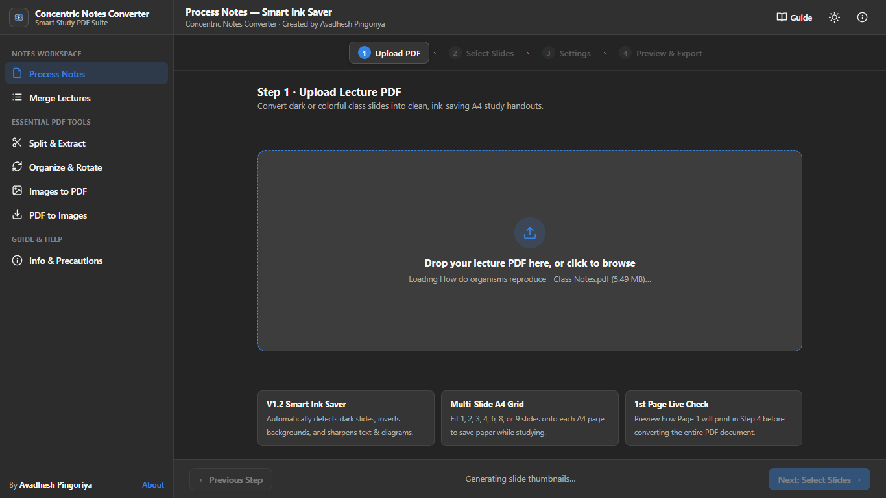
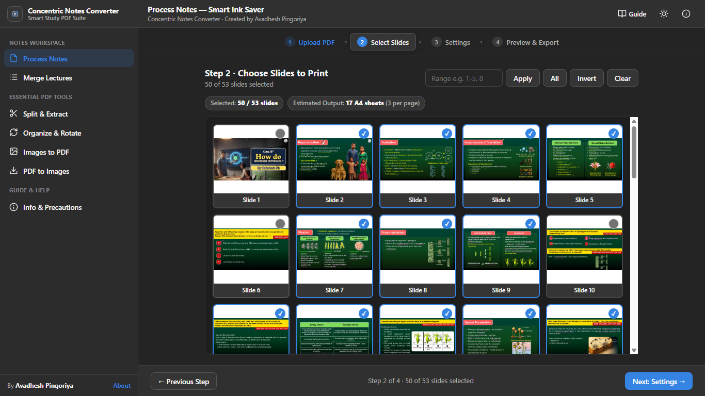
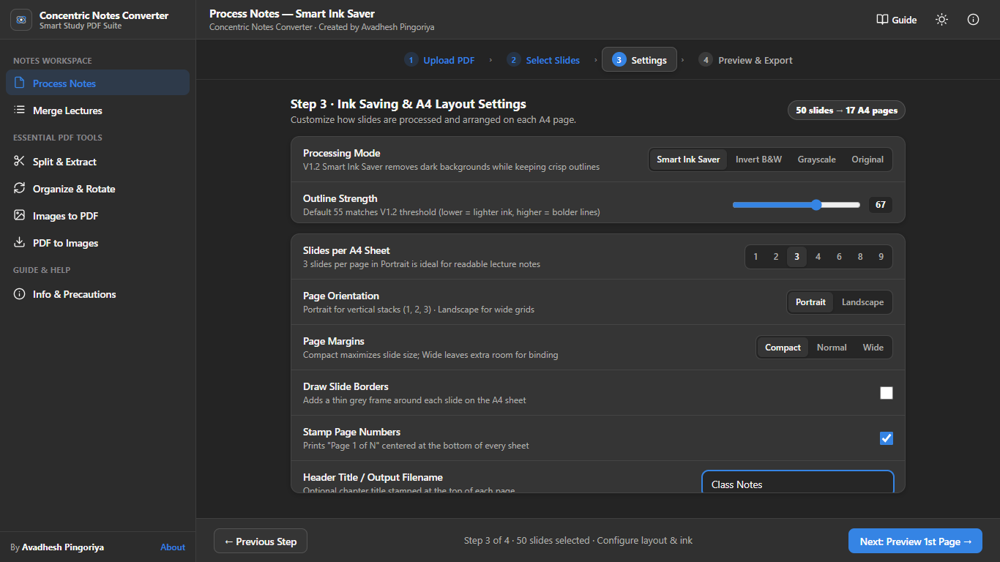
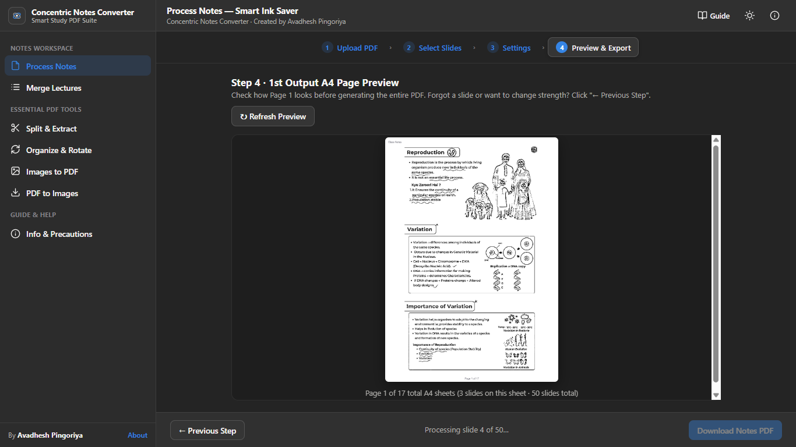

<div align="center">


# Concentric Notes Converter

### Turn lecture PDFs into cleaner, print-friendly study notes.

A student-focused PDF toolkit featuring **Smart Ink Saver**, slide selection, PDF organization, and image conversion.

[](https://concentric-notes-converter.vercel.app/)
[](#)
[](https://www.python.org/)

**[Open the web app](https://concentric-notes-converter.vercel.app/) · [View screenshots](#screenshots) · [Run locally](#run-locally)**

</div>

---

## What is it?

Concentric Notes Converter helps students prepare study material from lecture PDFs. Its main workflow lets you choose the slides you need, apply Smart Ink Saver, arrange the output for paper, preview the result, and export a new PDF.

It also includes everyday PDF utilities for combining, extracting, rotating, and converting documents.

## Screenshots

<p align="center">
  
  <br />
  <sub><strong>01 · Upload</strong> · Start with a lecture or notes PDF.</sub>
</p>

<p align="center">
  
  <br />
  <sub><strong>02 · Select slides</strong> · Choose the pages you want to keep.</sub>
</p>

<p align="center">
  
  <br />
  <sub><strong>03 · Tune the output</strong> · Configure Smart Ink Saver and page layout.</sub>
</p>

<p align="center">
  
  <br />
  <sub><strong>04 · Preview and export</strong> · Check the result before saving.</sub>
</p>

## Features

| Tool | What it does |
|---|---|
| **Process Notes** | Select PDF pages, apply Smart Ink Saver, arrange pages, preview, and export. |
| **Smart Ink Saver** | Detects dark slide content and processes it into a more print-friendly result. |
| **Merge Lectures** | Combine multiple PDF files into one document. |
| **Split & Extract** | Extract selected pages into a separate PDF. |
| **Organize & Rotate** | Reorder pages and rotate them. |
| **Images to PDF** | Combine image files into a PDF. |
| **PDF to Images** | Convert PDF pages into image files. |

> **Note:** Smart Ink Saver changes the appearance of processed pages. Always preview the output and keep your original PDF, especially when slides contain fine diagrams, coloured annotations, or small text.

## How it works

Concentric Notes Converter uses a hybrid browser + Python architecture. The browser provides the interface, previews, page selection, and client-side PDF tools. The Flask backend handles PDF rendering and image processing when the backend route is selected. The app can also fall back to browser-side processing for supported operations.

### 1. Application flow

```text
User opens the web app
        |
        v
Browser loads the HTML, CSS, and JavaScript interface
        |
        v
PDF.js reads the selected PDF and renders page previews
        |
        v
User selects pages and configures output options
        |
        v
JavaScript chooses an available processing path
        |-------------------------------|
        v                               v
Flask backend                    Browser-side fallback
PyMuPDF + OpenCV + Pillow        PDF.js + PDF-lib + Canvas
        |                               |
        |---------------|---------------|
                        v
             Generated PDF / ZIP file
                        |
                        v
              Preview or download
```

The app checks the backend health endpoint (`/api/health`) when the page loads. For supported tasks, it uses the Flask endpoint when the backend is available and the total input size is at or below **4 MiB**. Otherwise, it uses the browser-side implementation where available. This 4 MiB value is a routing threshold for the current implementation, not the maximum file size accepted by the interface.

### 2. Process Notes workflow

1. **Upload:** Select a lecture PDF. The app reads the document and prepares page previews.
2. **Preview:** PDF.js renders the PDF pages so you can inspect the lecture before processing.
3. **Select:** Choose individual slides, select all, or clear the selection.
4. **Configure:** Choose the processing mode, slides per sheet, page orientation, margins, and optional output details.
5. **Preview output:** Generate a preview of the first output sheet to check readability and layout.
6. **Export:** The selected pages are rendered, processed, placed onto A4 pages, and exported as a new PDF.

Available layouts are **1, 2, 3, 4, 6, 8, or 9 slides per sheet**. Portrait and landscape page orientations are supported. The output can also include a header, page numbers, and optional slide borders.

### 3. How Smart Ink Saver works

Smart Ink Saver is an image-processing pipeline intended for lecture slides with dark or strongly coloured backgrounds. It converts each selected slide into a high-contrast black-and-white image. The current algorithm follows these steps:

1. **Grayscale conversion:** The source image is converted to grayscale so the processing can focus on brightness and contrast.
2. **Dark-slide detection:** The algorithm checks the average brightness of the slide and its border area. If the slide appears predominantly dark, it inverts the grayscale image.
3. **Local contrast enhancement:** CLAHE (Contrast Limited Adaptive Histogram Equalization) improves local contrast, which can help faint text and outlines stand out.
4. **Light smoothing:** A small Gaussian blur reduces minor compression noise before thresholding.
5. **Adaptive thresholding:** Each local area is evaluated against its neighbourhood to classify pixels as black or white. The strength control adjusts the threshold bias.
6. **Small-noise cleanup:** Connected-component analysis removes tiny isolated dark marks while keeping larger connected content.
7. **PDF layout:** The processed slide image is fitted into the selected A4 sheet layout.

**Important:** This is a threshold-based image conversion, not OCR or semantic document understanding. It does not know which pixels are text, diagrams, annotations, or decoration. Fine lines, coloured highlights, photographs, gradients, and small text may change or disappear. Always inspect the preview and retain the original PDF.

### 4. Other PDF tools

| Tool | Processing flow | Output |
|---|---|---|
| **Merge Lectures** | Load multiple PDFs, preserve the chosen file order, and append their pages into one document. | One combined PDF |
| **Split & Extract** | Preview the source pages, select the pages to keep, and create a new document from that selection. | Extracted PDF |
| **Organize & Rotate** | Arrange page order and apply page rotation before exporting. | Reorganized PDF |
| **Images to PDF** | Add images, optionally apply an image mode, and place each image on an A4 portrait, A4 landscape, or image-sized page. | PDF |
| **PDF to Images** | Select PDF pages, render them at 2× scale, and package the chosen pages as PNG or JPEG files. | ZIP archive of images |

### 5. Browser-side and backend processing

The project includes two processing paths for supported tools:

- **Python backend:** Flask routes use PyMuPDF for PDF reading, page rendering, assembly, rotation, and export. Pillow and OpenCV handle image conversion and Smart Ink Saver processing. NumPy supports the image-processing operations.
- **Browser fallback:** PDF.js renders PDF pages in the browser. PDF-lib creates and edits PDFs, Canvas applies the JavaScript image-processing implementation, and JSZip packages exported images.

The fallback helps the web app handle cases where the backend is unavailable or a task is routed away from the hosted backend. Browser-side processing uses the device's available memory and CPU, so very large PDFs can still be slow or run out of memory.

## Recommended system requirements

These are practical recommendations based on the application's processing approach, not results from formal performance benchmarks. Actual performance depends on PDF page count, page dimensions, image complexity, selected tools, and other applications running at the same time.

### Using the hosted web app

When you use the [hosted web app](https://concentric-notes-converter.vercel.app/), the Python backend runs on the hosting platform. Your device mainly needs to run a modern browser and handle browser-side previews or fallback processing.

| Component | Minimum target | Recommended |
|---|---|---|
| Processor | 64-bit, 2-core CPU | Recent 4-core CPU |
| RAM | 4 GB | 8 GB or more |
| Browser | Recent Chrome, Edge, or Firefox | Latest stable 64-bit version |
| Display | 1280 × 720 | 1366 × 768 or higher |
| Internet | Required to open the hosted app and load its resources | Stable broadband connection |
| Graphics | Integrated graphics | Integrated graphics; no dedicated GPU required |

### Running the project locally

| Component | Minimum target | Recommended |
|---|---|---|
| Operating system | 64-bit Windows or Linux | Updated 64-bit Windows 10/11 or a modern Linux distribution |
| Processor | 64-bit dual-core CPU | 4-core CPU for larger documents and multitasking |
| RAM | 4 GB | 8 GB or more for larger PDFs |
| Storage | 1 GB free space for setup and small jobs | 2 GB or more free, plus extra space for source PDFs and exported files |
| Python | Python 3.12 | Python 3.12.x |
| Browser | Recent Chrome, Edge, or Firefox | Latest stable 64-bit browser |
| Graphics | Integrated graphics | Integrated graphics; no dedicated GPU required |

**macOS:** The source uses Python and browser technologies, but macOS has not been verified as a supported platform in this project. Treat it as untested until validated.

### Choosing hardware for your workload

- **Small PDFs and occasional conversions:** 4 GB RAM and a dual-core processor may be sufficient.
- **Regular study use:** 8 GB RAM is a sensible target for previews, multiple browser tabs, and PDF processing.
- **Large or image-heavy PDFs:** 8–16 GB RAM and a modern multi-core processor provide more headroom. Keep additional free storage for input files, temporary processing, and output files.

A dedicated graphics card is not required. Most of the application's work is PDF parsing, rendering, and CPU-based image processing.

> These figures are guidance, not guaranteed limits. The backend currently declares a 200 MB Flask request limit, but the hosting provider may impose lower request-size, memory, or execution-time limits. The configured limit does not guarantee that a hosted deployment can process a file of that size.

## Run locally

### 1. Requirements

- Python 3.12.x
- pip
- Git (optional, if cloning the repository)
- Internet access during the initial dependency installation

### 2. Get the source

```bash
git clone https://github.com/avadhesh0003/concentric-notes-converter.git
cd concentric-notes-converter
```

Or download and extract the repository ZIP from GitHub.

### 3. Create a virtual environment

**Windows (Command Prompt):**

```bat
py -3.12 -m venv .venv
.venv\Scripts\activate
```

**Linux:**

```bash
python3.12 -m venv .venv
source .venv/bin/activate
```

### 4. Install dependencies

```bash
python -m pip install --upgrade pip
pip install -r requirements.txt
```

### 5. Start the app

```bash
python app.py
```

Open the local address in your browser:

```text
http://127.0.0.1:5000
```

Stop the local server with `Ctrl+C` in the terminal.

## Project structure

```text
concentric-notes-converter/
├── app.py                      # Flask app, PDF routes, and Smart Ink Saver algorithm
├── requirements.txt            # Python dependencies
├── runtime.txt                 # Python runtime for deployment
├── Procfile                    # WSGI process entry point
├── vercel.json                 # Vercel deployment configuration
├── templates/
│   └── index.html              # Main web interface and page structure
├── static/
│   ├── app.js                  # UI logic, PDF.js, browser fallback, and interactions
│   ├── style.css               # Responsive interface styling and themes
│   └── concentric-mark.svg     # Application logo
└── screenshots/                # Screenshots used in this README
```

## Backend API overview

The Flask application exposes the following routes for the web interface:

| Route | Method | Purpose |
|---|---|---|
| `/` | GET | Serves the main application interface. |
| `/api/health` | GET | Reports backend availability and application version. |
| `/preview` | POST | Reads a PDF and returns low-resolution page thumbnails. |
| `/preview-sheet` | POST | Builds a preview image of the first configured output sheet. |
| `/process` | POST | Generates printer-friendly notes from selected PDF pages. |
| `/merge` | POST | Combines multiple PDF files. |
| `/organize` | POST | Extracts, reorders, and rotates pages based on the submitted operations. |
| `/images-to-pdf` | POST | Converts uploaded images into a PDF. |
| `/pdf-to-images` | POST | Renders selected PDF pages and returns them in a ZIP archive. |
| `/static/<path>` | GET | Serves frontend assets. |

These are application endpoints used by the frontend, not a separately versioned public API. Request formats may change as the project evolves.

## Technology stack

| Layer | Technology | Responsibility |
|---|---|---|
| Web server | Flask | Routes requests and serves the application. |
| PDF engine | PyMuPDF | Opens, renders, combines, rotates, and exports PDF pages. |
| Image processing | OpenCV | CLAHE, thresholding, blur, and connected-component cleanup. |
| Image handling | Pillow | Converts and encodes image data. |
| Numerical operations | NumPy | Pixel arrays and image calculations. |
| PDF preview | PDF.js | Loads PDFs and renders page previews in the browser. |
| Browser PDF editing | PDF-lib | Creates, combines, and edits PDF files client-side. |
| ZIP export | JSZip | Packages page images for download. |
| Frontend | HTML, CSS, JavaScript | User interface, workflow, previews, and browser fallback. |

## Deployment

The repository includes a Vercel configuration (`vercel.json`) and a Python runtime declaration (`runtime.txt`). The hosted application is available at:

**[https://concentric-notes-converter.vercel.app/](https://concentric-notes-converter.vercel.app/)**

After changing the source code, deploy the updated repository through the configured Vercel project. Check the deployment logs and test the hosted application after each deployment. Hosting platforms can enforce request-size, memory, and execution-time limits that differ from the local Flask configuration.

## Privacy and file handling

- **Hosted app:** Files sent to backend routes are processed by the hosted application. Do not upload confidential or sensitive documents unless you are comfortable with the deployment's data-handling arrangements.
- **Local app:** When running locally, backend processing takes place on your own computer. Browser fallback processing also runs in your browser.
- **Temporary data:** Processing may hold document and image data in memory. Avoid closing the browser or stopping the local server while a task is running.
- **Original files:** Keep a copy of the original PDF. Review exported files before printing, sharing, or deleting the source.
- **File limits:** The Flask app configures a 200 MB request limit, but hosted platform limits may be lower. Browser memory can also limit the size of files that can be processed reliably.

## Troubleshooting

| Problem | Things to check |
|---|---|
| Page previews do not load | Try a valid, non-password-protected PDF and refresh the page. Check that browser resources are loading. |
| Processing is slow | Try fewer pages, reduce the size of the source PDF, close unnecessary tabs, or use a device with more available RAM. |
| Smart Ink Saver removes fine details | Try a different processing mode or adjust strength. Keep the original and inspect the preview before exporting. |
| Browser reports an error or runs out of memory | Use a smaller PDF or process fewer pages at a time. |
| Local app does not start | Confirm Python 3.12 is active, dependencies installed successfully, and port 5000 is available. |
| Hosted app behaves differently from local | Check the hosting deployment logs and remember that hosted platforms may enforce stricter resource limits. |

If you report a bug, include your operating system, browser, Python version (for local use), approximate PDF size and page count, the steps to reproduce the issue, and any error message. Do not attach private or copyrighted PDFs unless you have permission.

## Contributing

Bug reports, feature suggestions, and code contributions are welcome. Before submitting a change:

1. Explain the problem or improvement clearly.
2. Keep changes focused where possible.
3. Test the affected tool with a small PDF and, where relevant, a larger document.
4. Include screenshots or clear reproduction steps for interface changes.
5. Avoid committing private documents, generated output PDFs, credentials, or temporary files.

## Roadmap

Possible future improvements include better large-file handling, more preview controls, additional output-layout options, expanded automated tests, and broader operating-system testing. The roadmap may change as the project develops.

## License

**No open-source license has been selected yet.** Until a license is added to this repository, all rights remain with the copyright holder. Please do not assume the code is public domain or freely reusable.

## Author

**Avadhesh Pingoriya**

- GitHub: [@avadhesh0003](https://github.com/avadhesh0003)
- Repository: [Concentric Notes Converter](https://github.com/avadhesh0003/concentric-notes-converter)

<div align="center">

Made for more practical, print-friendly study notes.

[**Launch Concentric Notes Converter ↗**](https://concentric-notes-converter.vercel.app/)

</div>
